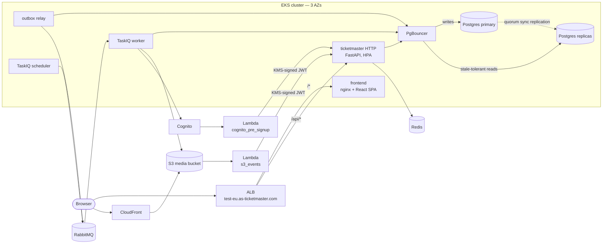

# Ticketmaster — a Ticket Booking Platform from Scratch

A pet project where I build an online platform for browsing and booking tickets to live events — sport games, concerts, and theater shows. "Design Ticketmaster" is a classic system-design question; here I wanted to answer it with running code instead of boxes on a whiteboard: a booking flow that cannot double-sell a ticket, a read path that survives traffic, background work that is never lost, and a deployment I can tear down and rebuild with one command.

The platform runs on AWS (EKS, Frankfurt) as one Python backend with four process types, a React frontend, two Lambdas, and a self-hosted highly available Postgres. It is not affiliated with Ticketmaster the company.

---

## What the Product Does

- **Browse events** — a paginated catalogue sortable by date or price, plus full-text search over names and descriptions.
- **Watch a trailer** — each event can carry a video trailer, served from a CDN.
- **Reserve, then book** — a signed-in user reserves a ticket, which holds it for 10 minutes, and then books it. Two people can never end up holding the same ticket.
- **Sign in with Google** — through Amazon Cognito's hosted UI. A profile page shows the account and lets the user delete it.
- **Administer events** — an admin API creates, updates, and deletes events and uploads trailers.

## Architecture



Postgres runs inside the cluster; RabbitMQ and Redis are managed services outside it.

## Code Organization

The backend is a single deployable service at `src/ticketmaster/`. The first-level split inside it is by **communication protocol** — `http/`, `background_tasks/`, and a planned `grpc/` — not by technical layer. Each protocol folder has its own entry point; shared domain code (models, repositories, services, schemas, settings) lives at the service root and is used by all of them. The admin API is a separate slice under `admin/` with its own routes, services, and repositories.

Dependencies point one way: routes → services → repositories → models. Repositories return frozen DTOs, never ORM objects, and never commit — the route, task, or relay loop that opened the transaction owns it.

All process types share one Docker image. The HTTP server, the TaskIQ worker, the outbox relay, the scheduler, and the migration Jobs are the same image with a different command.

---

## Booking

### No Double-Booking Without Locks

The core invariant — one ticket, one owner — is enforced by a single conditional `UPDATE`, not by `SELECT ... FOR UPDATE` and not by a distributed lock:

- **Reserve** flips a ticket to `reserved` only where it is `available`, or `reserved` by someone whose hold is older than 10 minutes.
- **Book** flips it to `booked` only where it is `reserved` by the same user and the hold has not expired.

The request succeeds if exactly one row was updated. When two users race for the same ticket, Postgres serializes the two updates on the row; the second one re-evaluates its `WHERE`, matches nothing, and gets a `400`. There is no read-then-write gap to exploit.

### Lazy Reservation Expiry

Nothing sweeps expired reservations. An expired hold is simply a row the next `reserve` is allowed to take over, because the expiry is part of that same `WHERE` clause. This removes a whole moving part — no scheduled job, and no window where a sweeper and a booking disagree about who owns the ticket.

### Account Deletion

Deleting an account happens in one transaction: held reservations go back to `available`, booked tickets become `anonymous_booked` with the user reference cleared, the user row is deleted, and a "delete the Cognito user" message is written to the outbox. The seat stays sold, the person is gone.

---

## Browsing

### Keyset Pagination with Signed Cursors

Event lists use keyset pagination on `(sort column, id)` with a tuple comparison, backed by composite indexes — page 500 costs the same as page 1. The cursor handed to the client is base64 JSON signed with HMAC-SHA256, so it is opaque and cannot be tampered with; a forged cursor is a `422`.

### Full-Text Search

Search runs on Postgres itself. The `event` table has a generated `tsvector` column (name weighted above description) with a GIN index; queries go through `websearch_to_tsquery` and are ordered by `ts_rank`, paginated by `(rank, id)`.

### Redis Cache

The event list is the hottest read, so it is cached in two layers:

- **Pages store ids, not events.** A cached page holds the event ids and the next cursor. Only the first few pages are cached — deep pages are rare and not worth the memory.
- **Events are cached individually** and hydrated with one `MGET`; only the misses go to Postgres. One event document is shared by every page and by the event-details endpoint.

Both have a 5-minute TTL, and every key carries the service version, so a deploy that changes a cached schema never reads the old shape.

**Invalidation is by namespace rotation.** Page keys include a namespace UUID stored in Redis. Any admin write generates a new one, which orphans every cached page at once without scanning or deleting keys; the orphans expire by TTL.

Redis is strictly an optimization: every cache read and write suppresses Redis errors and falls back to Postgres.

---

## Data Layer

### Highly Available Postgres

Postgres 18 runs in the cluster as a 3-member **Patroni** cluster — one pod per availability zone, each with its own encrypted gp3 volume, using the Kubernetes API as the consensus store. Replication is quorum-synchronous: a commit is acknowledged only after at least one replica has it, so losing the primary loses no committed data. Patroni labels each pod with its role, and two Services select on that label — `postgres-primary` and `postgres-replica` — so failover is a label change, not a config change.

### Read/Write Split Through PgBouncer

The app never connects to Postgres directly. A transaction-mode PgBouncer exposes two logical databases: `ticketmaster` routes to the primary and `ticketmaster_ro` to the replicas. The code has two session factories to match — a primary session and a `ReadSession`.

Routing is an explicit choice at each call site, not something inferred from the SQL. Catalogue reads (list, search, event details, ticket list) tolerate a few milliseconds of staleness and use `ReadSession`. Anything that must read its own writes — reserving, booking, authentication, the whole admin API, background tasks — uses the primary.

Migrations and tests bypass PgBouncer through a third, direct URL.

### Zero-Downtime Migrations

Alembic uses an **expand/contract** branching strategy, run as two Kubernetes Jobs either side of the rollout:

1. **Expand** — runs *before* the new code. Adds tables, columns, and indexes. The old code keeps working because it ignores what it doesn't know.
2. **Contract** — runs *after* every pod is on the new version. Drops what nothing references any more.

At no point is running code incompatible with the schema.

---

## Background Work

### Transactional Outbox

Some side effects live outside the database: deleting a trailer from S3 when its event is deleted, deleting the Cognito user when an account is deleted. Publishing to RabbitMQ from the request would create a dual-write — the database commits and the publish fails, or the reverse.

Instead, the request inserts a row into `outbox_message` **in the same transaction** as the business change. A separate **outbox relay** process drains the table: it selects a batch with `FOR UPDATE SKIP LOCKED`, publishes it to RabbitMQ, deletes only the rows the broker acknowledged, and commits. `SKIP LOCKED` is what makes it safe to run two relay replicas — each locks a disjoint set of rows.

### Inbox and Idempotency

The relay gives **at-least-once** delivery: if it crashes between publishing and committing, the row is published again. So every task starts by inserting `(logical_id, code)` into `inbox_message` with `ON CONFLICT DO NOTHING`, in the same transaction as its work. A duplicate finds the row already there and exits. A task that fails rolls its inbox row back too, so the retry is not mistaken for a duplicate.

### Tasks, Retries, and Schedules

Tasks run on **TaskIQ** over RabbitMQ. Each task takes one typed message with a stable numeric `code`. Execution is capped at 60 seconds; failed tasks are retried up to 5 times with jitter through a delay queue, then land in a dead-letter queue. A single-replica TaskIQ scheduler fires cron tasks — currently a nightly job that trims inbox rows older than 14 days.

### Topology as Code

The RabbitMQ topology — exchange, quorum queues, delay and dead-letter queues — is declared in its own package, `rabbitmq_topology`, and applied by a Kubernetes Job before any service starts. The worker declares nothing; it only checks that the queues exist. The broker's shape lives in one place and cannot drift.

---

## Authentication

There are three kinds of caller, and no shared secrets between any of them.

- **Users** sign in with Google through Cognito's hosted UI. The backend verifies the Cognito ID token against the user pool's JWKS (cached, refreshed once on a signature failure) and loads the matching user row.
- **Lambdas** call the backend with short-lived JWTs signed by **AWS KMS**. The private key never leaves KMS; the backend fetches the public key with `kms:GetPublicKey` and verifies in-process.
- **Admins** have no login page. A management command signs a 15-minute token with a dedicated KMS key, using the caller's AWS identity as the subject — being an admin means having IAM permission to sign with that key.

User rows are created by a **Cognito PreSignUp Lambda**, which calls the backend before Cognito confirms the sign-up. If the backend rejects the user, so does Cognito, and the two never disagree about who exists.

## Media

Trailers never pass through the backend:

1. The admin API returns a presigned S3 `PUT` URL, with the event's identity attached as object metadata.
2. The client uploads straight to S3.
3. S3 notifies the `s3_events` Lambda, which forwards the object's key and metadata to the backend with a KMS-signed JWT.
4. The backend links the trailer to the event and rotates the cache namespace.

The bucket is private. CloudFront reads it through Origin Access Control and serves the trailers; the API just returns the CDN URL.

---

## Shared Library

`src/libs/` is a separate package, `ticketmaster-libs`, published to CodeArtifact. It holds everything that is not domain logic: FastAPI middleware (body size limit, request ID, request/response logging, security headers, request timeout, exception handling), the SQLModel base model and session factories, Redis cache base classes, TaskIQ middlewares and message base class, a KMS public-key cache, signed-cursor helpers, Alembic helpers, logging and Sentry setup, settings mixins, and reusable test fixtures.

Locally the root workspace depends on it by path, so changes are picked up immediately. The service image installs the published version instead, and CI fails any pull request that changes a package without bumping its version.

## Cross-Cutting Concerns

**Request tracing.** Every request gets an `X-Request-ID`, stored in a `ContextVar`, and stamped on every log line. An outbox message takes the request ID as its logical ID, which becomes the task ID — so one ID follows a user action from the HTTP request to the S3 delete.

**Logging and errors.** Structured JSON to stdout on deployed environments, human-readable locally. Errors and traces go to Sentry.

**Failing fast.** Requests are capped at 20 seconds and 1 MiB, statements at 15 seconds. A statement timeout becomes a `504`, a lost database connection a `503`.

---

## Infrastructure

### Kubernetes

The cluster is EKS Auto Mode with the built-in node pools turned off and three static node pools instead, one per availability zone. Workloads spread across zones, so the stand survives the loss of a node or a zone.

| Workload | Replicas |
|----------|----------|
| `ticketmaster` (HTTP) | 3–5, HPA on CPU |
| `ticketmaster-worker` | 2 |
| `ticketmaster-outbox-relay` | 2 |
| `ticketmaster-scheduler` | 1 |
| `frontend` | 3 |
| `pgbouncer` | 2 |
| `postgres` (Patroni) | 3 |

One internet-facing ALB terminates TLS and dispatches by path: `/api/*` to the backend, everything else to the frontend.

### GitOps

**Argo CD is the only writer to the cluster.** CI never runs `kubectl apply` or `helm upgrade` and holds no cluster credentials. It renders the Helm chart with `helm template` and pushes plain manifests to an orphan branch, `env/test-eu`; Argo CD watches that branch and syncs it, pruning and self-healing.

The render is byte-deterministic, so a pipeline run that changes nothing commits nothing. Deleting a template deletes the resource. Rollback is a `git revert` on the env branch.

Rollout order comes from Argo CD sync waves:

| Wave | What |
|------|------|
| `-10` | Secrets, service accounts, ingress class |
| `-8` | Postgres, PgBouncer |
| `-5` | RabbitMQ topology Job, **expand** migration Job |
| `0` | Backend, worker, relay, scheduler, frontend, ingress |
| `5` | **Contract** migration Job |
| `10` | The Argo CD Application itself |

The Application is rendered from the same chart, so Argo CD manages its own spec.

### Secrets and Identity

Secrets live in AWS Secrets Manager and SSM Parameter Store and are synced into Kubernetes by External Secrets Operator — workloads only ever see ordinary Kubernetes Secrets. The backend reaches AWS through EKS Pod Identity, so no static AWS credentials are stored in the cluster.

### CI/CD

**On pull request:** Ruff lint and format check, tests against real Postgres, Redis, and RabbitMQ with a coverage floor, version-bump validation, `cfn-lint` on the Lambda templates, and a full Helm render validated with `kubeconform`.

**On push to `test/**`:** publish the shared library → build and push images → render manifests to the env branch. The two Lambdas deploy in parallel through CloudFormation.

### Disposable Environment

`just test-stand-up` creates the whole stand — cluster, node pools, External Secrets, Argo CD, DNS — and waits until the site answers. `just test-stand-down` removes it. Everything stateful outside the cluster survives; the Postgres data does not, by design.

---

## Tech Stack

**Language:** Python 3.14, fully async

**Backend:** FastAPI, SQLModel, Alembic, Pydantic, TaskIQ, redis-py, aioboto3, PyJWT

**Frontend:** React 19, TypeScript, Vite, React Router, AWS Amplify, nginx

**Data:** PostgreSQL 18 (Patroni), PgBouncer, Redis, RabbitMQ

**AWS:** EKS, ALB, CloudFront, S3, Cognito, KMS, Lambda, CloudFormation, ECR, CodeArtifact, Secrets Manager, SSM, Route 53, ACM

**Delivery:** GitHub Actions, Helm, Argo CD, External Secrets Operator, Docker

**Tooling:** Poetry (monorepo workspace), Ruff, pytest, factory-boy, respx, pre-commit, just

## Local Development

```bash
# Install dependencies
poetry install

# Start local infrastructure (Postgres, Redis, RabbitMQ)
just up-infra

# Run linting and tests
poetry run ruff check --fix .
poetry run ruff format .
just test
```

Tests need nothing beyond `just up-infra`. Running the app also needs settings — environment variables or a gitignored `src/ticketmaster/env.dev.yaml` — and, because Cognito and KMS are not emulated locally, AWS credentials for the test environment.

```bash
# Apply migrations
poetry run alembic -c src/ticketmaster/alembic.ini upgrade expand@head
poetry run alembic -c src/ticketmaster/alembic.ini upgrade contract@head

just rabbitmq-topology   # declare exchanges and queues (needs RABBITMQ_URL)
just runserver           # API on :8080, docs at /api/docs
just runworker           # TaskIQ worker
just runrelay            # outbox relay
just runscheduler        # cron tasks
just runui               # frontend on :5173, proxies /api to :8080
```

The frontend reads its Cognito settings from `frontend/public/config.js`; copy `config.example.js` and fill it in.

## Project Structure

```
src/
├── ticketmaster/                   # The backend service
│   ├── ticketmaster/
│   │   ├── http/                   #   FastAPI app, public /api/v1 routes
│   │   ├── admin/                  #   Admin API slice, management commands
│   │   ├── background_tasks/       #   TaskIQ worker, outbox relay, scheduler
│   │   ├── services/               #   Use cases
│   │   ├── redis_cache/            #   Cache documents and repositories
│   │   ├── schemas/                #   DTOs, task messages
│   │   ├── models.py               #   Event, User, Ticket, Outbox, Inbox
│   │   └── repositories.py         #   Data access
│   └── migrations/                 #   Alembic (expand/contract)
├── libs/                           # Shared library (ticketmaster-libs)
│   ├── fastapi_ext/                #   Middleware, exception handlers
│   ├── sqlmodel_ext/               #   Base model, session factories
│   ├── redis_ext/                  #   Cache base classes
│   ├── taskiq_ext/                 #   Middlewares, task messages
│   └── ...                         #   AWS, logging, Sentry, settings, test fixtures
├── rabbitmq_topology/              # Exchanges, queues, DLQs — applied as a Job
└── lambdas/
    ├── cognito_pre_signup/         # Creates the user row on sign-up
    └── s3_events/                  # Forwards S3 upload events to the backend

frontend/                           # React SPA + nginx

deploy/
├── chart/                          # Helm chart, rendered to the env branch
├── images/patroni/                 # Postgres + Patroni image
└── _scripts/                       # Stand up / tear down the environment
```

## Not Built Yet

Payments, seat maps, and ticket inventory management — booking changes a ticket's status and nothing else, and tickets are not yet created through the API. There is no admin UI, and `grpc/` is planned but empty.
